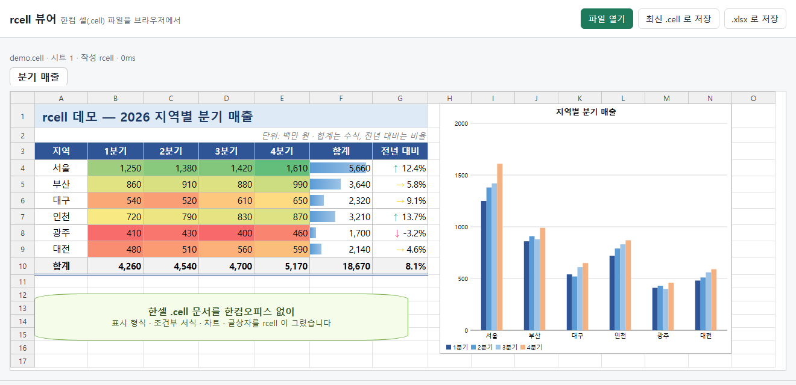
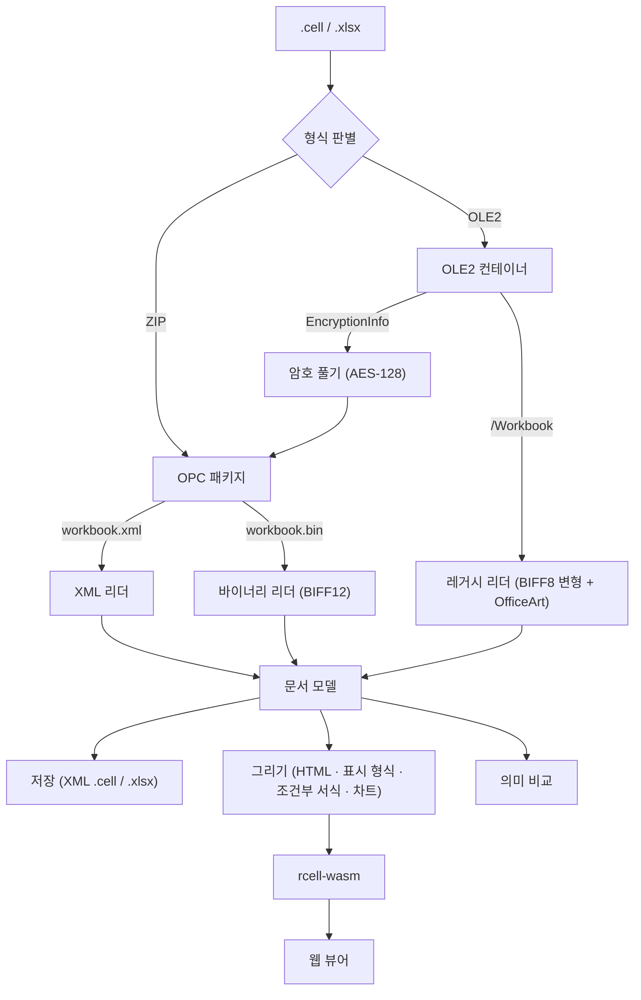

<!--
  Copyright 2026 yoomin53 (https://github.com/yoomin53)
  SPDX-License-Identifier: Apache-2.0
-->

<p align="center">
  
</p>

<h1 align="center">rcell</h1>

<p align="center">
  <strong>알(R)셀, 모두의 한셀</strong> — 한셀 문서를 누구에게나<br/>
  <em>Every Hancom Cell sheet, open for everyone</em>
</p>

<p align="center">
  <a href="https://github.com/yoomin53/rcell/actions/workflows/ci.yml"></a>
  <a href="https://yoomin53.github.io/rcell/"></a>
  <a href="https://www.apache.org/licenses/LICENSE-2.0"></a>
  <a href="https://www.rust-lang.org/"></a>
  <a href="https://webassembly.org/"></a>
</p>

<p align="center">
  <strong>한국어</strong> | <a href="README_EN.md">English</a>
</p>

---

한셀(한컴 셀) `.cell` 문서를 **어디서든** 열어 보세요. 무료, 설치 없이.

rcell 은 Rust + WebAssembly 로 만든 오픈소스 한셀 `.cell` 파서·뷰어·변환기입니다. 한셀이 쓰는 세 가지 저장 형식 —
XML, 바이너리, 한셀 2010 이하의 레거시 — 을 모두 읽고, 한셀 화면처럼 그리고, 최신 `.cell` 과 `.xlsx` 로 저장합니다.
[rhwp](https://github.com/edwardkim/rhwp) 가 한글 문서에 한 일을 한셀 문서에 합니다.

> **[온라인 데모](https://yoomin53.github.io/rcell/?file=samples/demo.cell)** | **[포맷 명세](docs/format/cell-2024.md)** | **[분석 방법](docs/reverse-engineering.md)** | **[로드맵](docs/ROADMAP.md)**

<p align="center">
  
</p>
<p align="center"><sub>rcell 웹 편집기가 그린 데모 문서 — <code>tools/demo/make-demo.js</code> 로 만든 문서이며 데이터는 지어낸 것입니다.</sub></p>

## 로드맵

읽고, 그리고, 저장한다 — 그리고 한셀이 하는 모든 일을 한셀과 같은 결과로 해낸다.

현재는 **v0.3 — 표현력** 단계입니다. 한셀 문서에 담기는 거의 모든 내용(보기·인쇄 설정, 메모, 도형·그림·차트,
조건부 서식, 개요·필터·보호 …)을 세 형식 모두에서 읽고 저장합니다. 다음은 **v0.4 — 계산과 편집**(수식 계산 엔진,
브라우저에서 편집, 레거시 형식 쓰기)입니다. 버전별 목표와 남은 일은 [로드맵](docs/ROADMAP.md)에 정리합니다.

## 현재 이정표

### v0.1 — XML `.cell` 읽기 ✅

- OOXML 기반 `.cell` 패키지, 한컴 `hs:` 확장 어휘 전체 모델링

### v0.2 — 세 형식 읽기·저장·표시 ✅

- 바이너리(`xlCellb`)·레거시(OLE2 + BIFF 변형) 읽기, 자체 OLE2 리더
- XML `.cell` / `.xlsx` 저장, 표시 형식 엔진, HTML 렌더러, WebAssembly 웹 뷰어

### v0.3 — 표현력 (현재)

> 한셀 문서의 내용을 빠짐없이 — 그리고 한셀이 읽은 결과와 똑같이

- 시트 보기·인쇄 설정, 메모, 도형·글상자·그림·차트, 레거시 OfficeArt 도형과 그림 저장소
- 조건부 서식·데이터 유효성, 개요(그룹)·자동 필터·보호, 외부 연결 캐시, 테마, 문서 속성
- 암호화 문서 열기(ECMA-376 표준 암호화)
- 레거시 차트(한컴 VtChart 직렬화) → 차트 모델 → XML 차트 파트: 한셀이 레거시를 읽은 차트와 바이트까지 같다
- 진행 중: 렌더러 다듬기

## Features

### Parsing (읽기)

- **XML `.cell`** — 한셀 2014 이후 기본 형식 (OOXML SpreadsheetML + 한컴 `hs:` 확장, `mc:AlternateContent` 스타일)
- **바이너리 `.cell`** — `xlCellb` (XLSB / BIFF12 계열)
- **레거시 `.cell`** — 한셀 2010 이하 계열 (OLE2 복합 문서 + BIFF8 변형: 32비트 행 번호, UTF-16 문자열, 한컴 전용 레코드)
- **암호화 문서** — ECMA-376 표준 암호화(AES-128). 한셀이 보호 문서에 거는 기본 암호는 자동으로 풀고, 사용자 암호는 `--password` 로 받습니다
- `.xlsx` / `.xlsb` 도 읽습니다
- Excel 97-2003 `.xls`, 넥셀 `.nxl`, ODF `.ods` (값·수식·구조·칸 서식), CSV·텍스트 (`.csv` `.txt` `.prn` — 한셀이 여는 규칙 그대로) — [그 밖의 형식](docs/format/other-formats.md)

### Document Model (문서 모델)

- 셀 값, 수식 원문(공유 수식·외부 참조·이름), 공유 문자열과 서식 있는 글
- 스타일 + 한컴 확장: 장평·자간·상대 크기·글자 위치·그림자·외곽선·양각/음각·강조점·문단 모양
- 시트 보기(틀 고정·나누기·확대율·선택), 인쇄 설정(여백·용지·배율·머리글/바닥글·페이지 나누기)
- 메모, 그리기 개체(도형·글상자·연결선·그룹·그림), 차트(종류·묶음·제목·범례·계열)
- 조건부 서식(셀 값·수식·상위/하위·평균·색조·데이터 막대·아이콘 집합)·데이터 유효성·차등 서식
- 개요(행·열 그룹)·자동 필터(값 목록·사용자 지정·상위/하위·동적)·시트/통합 문서 보호
- 외부 연결(값 캐시·경로 없는 연결), 테마, 문서 속성(제목·작성자·날짜)

### Rendering (그리기)

- **HTML 렌더러** — 글꼴·장평·자간·채우기·테두리·병합·정렬·줄 바꿈·틀 고정·확대율
- **표시 형식 엔진** — `#,##0`, 통화, 날짜·시간, 분수, 조건, 한국어 요일 … 한셀 화면 표시 742개와 일치
- **조건부 서식 평가** — 색조·데이터 막대·아이콘 집합·규칙 서식
- **도형·그림·차트** — 앵커 위치, 채우기·선·글, 테마 색, SVG 차트

### Output (저장·변환)

- XML `.cell` / `.xlsx` 저장 — 레거시·바이너리 문서를 최신 `.cell` 로 바꿉니다
- 바이너리 `.cell`(`xlCellb`) 저장 — 한셀이 바이너리로 저장하는 꼴 그대로 (레코드 98.9% 가 바이트까지 같다)
- 레거시 `.cell`(`xlCell8`) 저장 — 한셀이 -2005 로 저장하는 꼴 그대로 (한셀이 XML 을 열어 저장한 것과 레코드 97.7% 가 같다 — 저장마다 달라지는 SST 차례 등은 빼고, 차트·표는 아직)
- Excel 97-2003 `.xls` 저장 — 레거시 레코드를 BIFF8 로 바꿔 쓴다, 차트는 BIFF8 차트 부분 스트림 (한셀이 61개를 모두 열고 59개가 한셀 자기 `.xls` 와 같다)
- ODF `.ods` 저장 — 값·수식·구조·칸 서식
- 웹 페이지 `.htm`·`.mht` 저장 — 한셀의 웹 저장 꼴 (프레임 묶음·시트 쪽·mht, 도형·차트 그림은 제외)
- 넥셀 `.nxl` 저장 — 한셀 -2003 꼴 (BIFF8 틀 + 한컴 확장, 61개 중 58개가 한셀 자기 `.nxl` 와 같다)
- CSV·텍스트·PRN 저장 — 한셀 저장과 바이트까지 같다 (코드 페이지 949, 216/216), 문서 모델 JSON

### Editing (편집)

- **한셀처럼 편집** — 셀 입력(숫자·날짜·백분율·`'글`·수식 — 한셀 입력 규칙), 지우기, 행·열 삽입·삭제(모든 시트의
  수식·이름·병합·조건부 서식·유효성·메모·도형·차트 참조 조정), 서식·테두리·병합, 열 너비·행 높이, 시트 추가·이름
  바꾸기·삭제·옮기기, 복사·잘라 붙이기·채우기, 보호 — [편집 규칙](docs/editing.md)
- 편집마다 수식 다시 계산, 세 형식(XML·바이너리 `.cell`, `.xlsx`)으로 저장
- 한셀 판정: corpus 문서 48종 × 편집 대본 5종 중 225건이 한셀의 편집 결과와 같다

### Verification (한셀을 정답지로)

- **레거시 읽기** — 한셀이 같은 파일을 읽은 결과와 비교 (한셀 서식 파일 28종 + 값을 조작한 문서들)
- **바이너리 읽기** — 같은 문서를 한셀이 XML 로 저장한 것과 비교
- **저장** — 한셀이 원본을 읽은 결과와 한셀이 rcell 의 출력을 읽은 결과를 비교: 131쌍 일치
- **표시 형식** — 한셀 화면 표시 742개 일치

## 웹 뷰어 — 설치 없이 브라우저에서

`.cell` 파일을 끌어 놓으면 브라우저 안에서 바로 그리고, 한셀처럼 편집해 최신 `.cell`·바이너리 `.cell`·`.xlsx` 로
저장할 수 있습니다 (칸 고르기, 칸·수식 입력줄 입력, 복사·붙여넣기, 되돌리기, 서식 도구 막대, 행·열 삽입·삭제,
열 너비·행 높이 끌기, 시트 탭 — [편집 규칙](docs/editing.md)). 파일은 브라우저 밖으로 나가지 않습니다.

- 온라인: <https://yoomin53.github.io/rcell/> — `?file=경로` 로 바로 열 수 있습니다 (예: `?file=samples/demo.cell`)
- 로컬:

```bash
sh tools/build-web.sh                  # 또는 powershell -File tools/build-web.ps1
python3 -m http.server -d web 8000     # http://localhost:8000
```

### WebAssembly 직접 쓰기

`rcell.wasm` 은 wasm-bindgen 없이 C ABI 로 함수를 내보냅니다 (가져오는 함수 없음).

```javascript
const { instance } = await WebAssembly.instantiate(await (await fetch('rcell.wasm')).arrayBuffer(), {});
const w = instance.exports;
const bytes = new Uint8Array(await (await fetch('문서.cell')).arrayBuffer());

const ptr = w.rcell_alloc(bytes.length);
new Uint8Array(w.memory.buffer, ptr, bytes.length).set(bytes);
const packed = BigInt.asUintN(64, BigInt(w.rcell_render(ptr, bytes.length)));  // (포인터 << 32) | 길이
w.rcell_free(ptr, bytes.length);

const p = Number(packed >> 32n), n = Number(packed & 0xffffffffn);
const out = new Uint8Array(w.memory.buffer, p, n).slice();   // 첫 바이트: 'O' 성공 / 'E' 오류
w.rcell_free(p, n);
document.querySelector('#view').innerHTML = new TextDecoder().decode(out.subarray(1));
```

| 함수 | 결과 |
|------|------|
| `rcell_render` | 시트 HTML (스타일은 `rcell_css()`) |
| `rcell_info` | 문서 요약 JSON |
| `rcell_to_cell` / `rcell_to_xlsx` | 최신 XML `.cell` / `.xlsx` 파일 바이트 |
| `rcell_doc_open` / `rcell_doc_new` | 편집할 문서를 열고 번호를 돌려준다 |
| `rcell_doc_edit` | 편집 명령 JSON 하나 (`rcell::edit::Edit`) — 편집하고 다시 계산 |
| `rcell_doc_render` / `rcell_doc_cell` | 시트 HTML 과 칸 배치 / 칸 하나 (수식 입력줄 글·서식) |
| `rcell_doc_undo`, `rcell_doc_copy` / `rcell_doc_paste` / `rcell_doc_paste_text`, `rcell_doc_jump` | 되돌리기, 복사·붙이기(TSV), Ctrl+방향키 |
| `rcell_doc_save` | 저장한 파일 바이트 (0 XML `.cell`, 1 `.xlsx`, 2 바이너리 `.cell`) |
| `rcell_set_clock` | 지금 시각·시간대 (wasm 에는 시계가 없다 — `NOW()`·`TODAY()`) |

## Quick Start (소스 빌드)

### Requirements

- Rust stable (2024 edition)
- 웹 뷰어: `wasm32-unknown-unknown` 타깃 (`rustup target add wasm32-unknown-unknown`)

### Native Build

```bash
cargo build --release          # target/release/rcell
cargo test                     # 단위·통합 테스트 (한컴 파일 불필요)
```

### 라이브러리로 쓰기

```rust
let wb = rcell::open("문서.cell")?;               // XML / 바이너리 / 레거시 / 암호화 자동 판별
for sheet in &wb.sheets {
    for cell in &sheet.cells {
        let xf = wb.styles.xf(cell.style).unwrap();
        let code = rcell::numfmt::code_for(&wb.styles, xf.num_fmt_id);
        let shown = rcell::numfmt::format(&cell.value, &code, wb.date1904);
        println!("{}!{} = {}", sheet.name, cell.r, shown.text);   // 한셀 화면과 같은 문자열
    }
}
rcell::save(&wb, "새문서.cell")?;
```

## CLI Usage

### 보기·변환

```bash
rcell info    문서.cell                  # 요약 (세 형식 모두)
rcell html    문서.cell -o 문서.html     # 한셀 화면처럼 HTML 로
rcell pdf     문서.cell 문서.pdf         # 한셀 인쇄처럼 PDF 로 (페이지 나누기·배율·글꼴 넣기)
rcell pages   문서.cell                  # 시트마다 인쇄 페이지 수·페이지 나누기·배율
rcell csv     문서.cell -s 0             # 첫 시트를 CSV 로
rcell convert 옛문서.cell 새문서.cell    # 레거시/바이너리 → 최신 XML .cell
rcell convert 문서.cell 문서.xlsx        # Excel 형식으로
rcell convert 문서.cell 문서.bin.cell    # 바이너리 .cell 로 (--format bin, 한셀처럼 잃으려면 --exact)
rcell convert 문서.cell 문서.legacy.cell # 레거시 .cell 로 (--format legacy)
rcell convert 문서.cell 문서.xls          # Excel 97-2003 .xls 로 (--format xls)
rcell convert 문서.cell 문서.htm          # 한셀의 웹 페이지 저장 꼴 (문서.files/ 폴더 포함, .mht 는 한 파일)
rcell convert 문서.cell 문서.csv          # 활성 시트를 CSV 로 (한셀처럼 949, .txt 는 탭, .prn 은 공백)
rcell convert 자료.csv  자료.cell         # 한셀처럼 CSV·텍스트 파일 열기
rcell dump    문서.cell --no-cells       # 문서 모델 JSON
rcell info    잠긴문서.cell --password 암호   # 사용자 암호가 걸린 문서
```

### 편집

```bash
rcell edit 문서.cell 대본.json 결과.cell  # {"edits":[{"op":"set","cell":"B2","input":"=SUM(A1:A3)"}, …]} 를 실행·계산·저장
```

편집 명령은 [편집 규칙](docs/editing.md) 1절을 참고하세요.

### 비교

```bash
rcell diff a.cell b.cell                 # 두 문서의 의미 비교 (형식이 달라도 됨, 다르면 종료 코드 1)
rcell diff x.legacy.cell x.legacy.as.cell --ignore-font-scale --ignore-shape-detail
                                         # 한셀이 레거시에서 읽지 못하는 정보는 빼고 비교
```

### 리버스 엔지니어링 도구

```bash
rcell scan    폴더/                      # 한컴 확장 어휘 커버리지
rcell streams 문서.cell                  # ZIP 파트 / OLE2 스트림 목록
rcell records 옛문서.cell --only 0031    # 레거시 BIFF 레코드 (바이너리: --part xl/styles.bin)
rcell escher  옛문서.cell                # 레거시 그리기(OfficeArt) 도형
rcell hexdump 옛문서.cell /Workbook      # 16진수
rcell decrypt 잠긴문서.cell 풀린.zip     # 암호화된 패키지 풀기
rcell patch   a.cell b.cell --part xl/styles.xml=새.xml   # 파트 교체 (값 조작 실험)
```

### 분석 흐름

1. 알고 싶은 값을 넣은 XML 문서를 만든다 → `rcell patch`
2. 한셀로 세 형식 저장·다시 읽기 → `tools/probe/batch-formats.ps1` (Windows + 한셀 설치 필요)
3. `rcell records` / `escher` / `hexdump` 로 바뀐 바이트를 찾는다
4. 구현한 뒤 `rcell diff` 로 한셀의 해석과 맞춘다

코드를 고치지 않고 전 과정을 진행할 수 있습니다.

## Project Structure

```
src/
├── lib.rs                     # 공개 API (open, from_bytes, save)
├── main.rs                    # CLI
├── model.rs                   # 문서 모델 (한컴 확장 포함)
├── container.rs cfb.rs        # 형식 판별, ZIP·OLE2(MS-CFB) 컨테이너
├── crypto.rs                  # ECMA-376 표준 암호화 (SHA-1, AES-128)
├── xml.rs package.rs ns.rs    # XML DOM, OPC 패키지, 네임스페이스
├── parser/                    # XML .cell (시트·스타일·메모·그리기·차트)
├── binary/                    # 바이너리 .cell (BIFF12)
├── legacy/                    # 레거시 .cell
│   ├── reader.rs              # BIFF8 변형 레코드
│   ├── formula.rs ftab.rs     # 수식 토큰(Ptg) 해석, 함수 번호
│   ├── escher.rs              # OfficeArt 도형, 그림 저장소
│   ├── xls.rs                 # Excel 97-2003 .xls (BIFF8) ↔ 레거시 레코드
│   └── props.rs               # 문서 속성 (SummaryInformation)
├── writer.rs                  # XML .cell / .xlsx 저장
├── csv.rs                     # CSV·텍스트·PRN 읽기·쓰기 (한셀 규칙)
├── ods.rs                     # ODF .ods 읽기·쓰기 (칸 서식·쪽 모양 포함)
├── webpage.rs                 # 웹 페이지 .htm·.mht 쓰기 (한셀의 웹 저장 꼴)
├── edit/                      # 편집 (입력 규칙, 참조 조정, 서식·테두리·병합, 복사·붙여넣기, 시트)
├── numfmt.rs                  # 표시 형식 엔진
├── render.rs cf_eval.rs chart_svg.rs theme.rs units.rs image.rs   # 그리기
└── compare.rs scan.rs vocab.rs formula_text.rs                   # 의미 비교, 어휘 스캐너

crates/rcell-wasm/             # WebAssembly 인터페이스 (C ABI)
web/                           # 브라우저 뷰어 (+ samples/demo.cell)
tools/
├── probe/                     # 한셀 COM 자동화로 차분 분석 샘플·정답 만들기
├── demo/                      # 데모 문서 생성기
└── build-web.*                # 웹 뷰어 빌드
tests/                         # 단위·통합·한셀 정답 대조·저작자 표기 검사
docs/                          # 포맷 명세, 분석 방법, 로드맵
assets/                        # 로고, 스크린샷
```

## Architecture



## 단위

- **열 너비**: 글꼴 0(글꼴 목록의 첫 글꼴)의 숫자 폭 K(정수 px) 기준 글자 수. 한셀 안의 너비는 w·K px 그대로이고 화면은 열마다 반올림 (Excel 처럼 여백·8px 배수로 맞추지 않는다, [docs/format/screen.md](docs/format/screen.md))
- **행 높이**: 포인트. 1/20 pt 로 자르고 화면은 행마다 round(twips/15) px. 직접 정하지 않은 행 높이(customHeight 없음)는 열 때 그 행의 글꼴·테두리·줄 바꿈으로 다시 맞춘다
- **HWPUNIT**: 1 inch = 7,200. 한셀은 여백을 이 단위로 들고 있고, XML 을 읽을 때 잘라 버립니다
- **EMU**: 1 inch = 914,400, 1 px(96 dpi) = 9,525 EMU — 그리기 개체 위치
- **레거시 앵커**: dx = 열의 (픽셀 − 1) 의 1/32768, dy = 행의 (픽셀 − 1) 의 1/8192

## Contributing

기여 환영합니다. 다음 핵심 사항을 먼저 확인해 주세요:

- **저작자 머리말**: 모든 소스 파일은 `Copyright 2026 yoomin53` 과 SPDX 머리말로 시작합니다. `tests/attribution.rs` 가 검사합니다.
- **클린룸**: 한컴 소프트웨어의 디컴파일 결과·코드를 넣지 않습니다. 바이너리 분석은 사실 확인에만 쓰고, 알아낸 것은 `docs/format/` 에 사실로만 적습니다.
- **한컴 파일은 커밋하지 않습니다**: 한셀이 만든 문서는 저작물이거나 개인정보를 담을 수 있습니다. 테스트 픽스처는 직접 만듭니다.
- **한셀이 정답지 — 단, 한셀도 저장할 때 값을 바꿉니다**: 저장 결과는 원본 파일이 아니라 "한셀이 원본을 읽은 결과" 와 비교합니다.
  또 한셀은 바뀌지 않은 문서를 같은 형식으로 `SaveAs` 하면 파일을 그대로 복사하므로, `Workbook.Saved = False` 로 다시 쓰게 해야 합니다.
  자세한 내용은 [분석 방법](docs/reverse-engineering.md)을 참고하세요.

상세한 절차는 [CONTRIBUTING.md](CONTRIBUTING.md) 를 참고하세요.

### 문서

- [XML `.cell` 형식](docs/format/cell-2024.md) — `hs:` 한컴 확장, `mc:AlternateContent`, 열거형 값, 한셀이 다시 저장할 때 바꾸는 것
- [레거시 `.cell` 형식](docs/format/cell-legacy.md) — BIFF8 과의 차이, 한컴 레코드, OfficeArt·그림 저장소, 조건부 서식, 필터·보호, 문서 속성
- [바이너리 `.cell` 형식](docs/format/cell-binary.md) — XLSB 와의 관계, 한셀의 바이너리 저장이 잃는 것
- [그 밖의 형식](docs/format/other-formats.md) — 한셀이 여닫는 형식 표, CSV·텍스트 규칙, `.xlsx`, `.xls`, 넥셀
- [리버스 엔지니어링 방법](docs/reverse-engineering.md) — 클린룸 원칙, 한셀을 정답으로 쓰는 차분 분석, 판정 기준
- [편집 규칙](docs/editing.md) — 입력 규칙, 참조 조정, 테두리·병합, 복사·붙여넣기, 한셀 대조 결과
- [로드맵](docs/ROADMAP.md)

## Notice

본 프로젝트는 한컴 소프트웨어의 코드 없이, 공개 표준 문서(ECMA-376, [MS-XLS], [MS-XLSB], [MS-CFB], [MS-ODRAW],
[MS-OLEPS], [MS-OFFCRYPTO])와 한셀이 저장한 파일을 관찰한 차분 분석을 바탕으로 클린룸 방식으로 개발하였습니다.

## Trademark

"한컴", "한셀", "한컴오피스", "Hancom", "Hancom Cell" 은 주식회사 한글과컴퓨터의 상표 또는 등록 상표입니다.
본 프로젝트는 한글과컴퓨터와 제휴, 후원, 승인 관계가 없는 독립적인 오픈소스 프로젝트입니다.

"Hancom", "Hancom Cell", and "Hancom Office" are trademarks or registered trademarks of Hancom Inc.
This project is an independent open-source project with no affiliation, sponsorship, or endorsement by Hancom Inc.

## License

[Apache License 2.0](LICENSE) — Copyright 2026 **yoomin53** (<https://github.com/yoomin53>)

재배포하거나 파생 저작물을 만들 때는 [NOTICE](NOTICE) 의 저작자 표기를 함께 포함해야 합니다 (Apache-2.0 제4조 (d)항).
