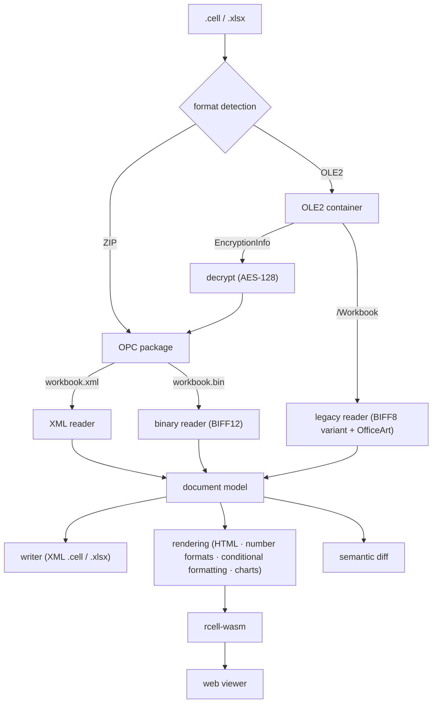

<!--
  Copyright 2026 yoomin53 (https://github.com/yoomin53)
  SPDX-License-Identifier: Apache-2.0
-->

<p align="center">
  
</p>

<h1 align="center">rcell</h1>

<p align="center">
  <strong>알(R)셀, 모두의 한셀</strong> — Hancom Cell documents for everyone<br/>
  <em>Every Hancom Cell sheet, open for everyone</em>
</p>

<p align="center">
  <a href="https://github.com/yoomin53/rcell/actions/workflows/ci.yml"></a>
  <a href="https://yoomin53.github.io/rcell/"></a>
  <a href="https://www.apache.org/licenses/LICENSE-2.0"></a>
  <a href="https://www.rust-lang.org/"></a>
  <a href="https://webassembly.org/"></a>
</p>

<p align="center">
  <a href="README.md">한국어</a> | <strong>English</strong>
</p>

---

Open Hancom Cell (한셀) `.cell` spreadsheets **anywhere**. Free, nothing to install.

rcell is an open-source `.cell` parser, viewer and converter written in Rust + WebAssembly. It reads all three formats
Hancom Cell saves — XML, binary, and the legacy format of Hancom Cell 2010 and earlier — renders sheets the way Hancom Cell
shows them, and saves modern `.cell` and `.xlsx`. It does for Hancom Cell what [rhwp](https://github.com/edwardkim/rhwp)
does for Hangul word-processor documents.

> **[Online demo](https://yoomin53.github.io/rcell/?file=samples/demo.cell)** | **[Format specs](docs/format/cell-2024.md)** | **[Method](docs/reverse-engineering.md)** | **[Roadmap](docs/ROADMAP.md)**

<p align="center">
  
</p>
<p align="center"><sub>A demo workbook rendered by the rcell web viewer — generated by <code>tools/demo/make-demo.js</code>; the data is made up.</sub></p>

## Roadmap

Read it, draw it, save it — and do everything Hancom Cell does, with the same result.

The current stage is **v0.3 — Expressiveness**: reading and saving nearly everything a Hancom Cell document can hold
(view and print settings, comments, shapes, pictures and charts, conditional formatting, outlines, filters, protection …)
in all three formats. Next is **v0.4 — Calculation and editing** (formula engine, in-browser editing, writing the legacy
format). Goals per version and the remaining work are tracked in the [roadmap](docs/ROADMAP.md).

## Milestones

### v0.1 — Reading XML `.cell` ✅

- OOXML-based `.cell` packages, the complete Hancom `hs:` extension vocabulary

### v0.2 — Three formats: read, save, render ✅

- Binary (`xlCellb`) and legacy (OLE2 + BIFF variant) readers, own OLE2 reader
- XML `.cell` / `.xlsx` writer, number-format engine, HTML renderer, WebAssembly web viewer

### v0.3 — Expressiveness (current)

> Everything in a Hancom Cell document — read exactly the way Hancom Cell reads it

- View and print settings, comments, shapes / text boxes / pictures / charts, legacy OfficeArt shapes and the picture store
- Conditional formatting, data validation, outlines (grouping), AutoFilter, protection, external-link caches, theme, document properties
- Opening encrypted documents (ECMA-376 standard encryption)
- Legacy charts (Hancom's VtChart serialization) → chart model → XML chart parts, byte-identical to Hancom Cell's own reading of the legacy file
- In progress: renderer polish

## Features

### Parsing

- **XML `.cell`** — the default since Hancom Cell 2014 (OOXML SpreadsheetML + Hancom `hs:` extensions, `mc:AlternateContent` styles)
- **Binary `.cell`** — `xlCellb` (XLSB / BIFF12 family)
- **Legacy `.cell`** — Hancom Cell 2010 and earlier (OLE2 compound file + a BIFF8 variant: 32-bit row numbers, UTF-16 strings, Hancom-specific records)
- **Encrypted documents** — ECMA-376 standard encryption (AES-128); the default password Hancom Cell uses for protected documents is handled automatically, user passwords via `--password`
- `.xlsx` / `.xlsb` are read too
- Excel 97-2003 `.xls`, Nexcel `.nxl`, CSV and text (`.csv` `.txt` `.prn` — opened with Hancom Cell's rules) — [other formats](docs/format/other-formats.md)

### Document model

- Cell values, formula text (shared formulas, external references, names), shared strings and rich text
- Styles + Hancom extensions: character width ratio, spacing, relative size, offset, shadow, outline, emboss/engrave, emphasis marks, paragraph shapes
- Sheet views (frozen/split panes, zoom, selection), print settings (margins, paper, scaling, headers/footers, page breaks)
- Comments, drawings (shapes, text boxes, connectors, groups, pictures), charts (type, grouping, title, legend, series)
- Conditional formatting (cell value, formula, top/bottom, average, color scale, data bar, icon set), data validation, differential formats
- Outlines (row/column grouping), AutoFilter (value lists, custom, top 10, dynamic), sheet/workbook protection
- External links (value cache, links whose path is missing), theme, document properties (title, author, dates)

### Rendering

- **HTML renderer** — fonts, width ratio, spacing, fills, borders, merges, alignment, wrapping, frozen panes, zoom
- **Number-format engine** — `#,##0`, currency, dates and times, fractions, conditions, Korean weekdays … matches 742 of 742 values displayed by Hancom Cell
- **Conditional formatting evaluation** — color scales, data bars, icon sets, rule formats
- **Shapes, pictures, charts** — anchor positions, fill/line/text, theme colors, SVG charts

### Output

- XML `.cell` / `.xlsx` — converts legacy and binary documents to modern `.cell`
- Binary `.cell` (`xlCellb`) — written the way Hancom Cell saves it (98.9% of records byte-identical)
- Legacy `.cell` (`xlCell8`) — written the way Hancom Cell saves it with -2005 (97.7% of records identical to Hancom Cell opening the XML and saving legacy, ignoring per-save values such as the SST order; charts and tables not yet)
- Excel 97-2003 `.xls` — legacy records transcoded to BIFF8 (Hancom Cell opens all 61 test files, 42 identical to its own `.xls`; charts not yet)
- CSV, text and PRN — byte-identical to Hancom Cell's save (code page 949, 216/216), document-model JSON

### Editing

- **Edits the way Hancom Cell does** — cell input (numbers, dates, percentages, `'text`, formulas — Hancom Cell input rules),
  clearing, row/column insert and delete (formulas on every sheet, names, merges, conditional formatting, validation,
  comments, shapes and chart references are adjusted), formatting, borders, merging, column widths and row heights,
  sheet add/rename/delete/move, copy/cut/paste/fill, protection — [editing rules](docs/editing.md) (Korean)
- Formulas are recalculated after every edit; saves to all three formats (XML and binary `.cell`, `.xlsx`)
- Hancom Cell as the oracle: 225 of 240 edits (48 corpus documents × 5 edit scripts) give the same document as Hancom Cell

### Verification (Hancom Cell as the oracle)

- **Legacy reading** — compared with Hancom Cell's own reading of the same file (28 Hancom Cell templates + crafted documents)
- **Binary reading** — compared with the same document saved by Hancom Cell as XML
- **Saving** — Hancom Cell's reading of the original vs. Hancom Cell's reading of rcell's output: 131 pairs identical
- **Number formats** — 742 of 742 displayed values identical

## Web viewer — in the browser, nothing to install

Drop a `.cell` file to render it in the browser, edit it the way Hancom Cell does and save it as modern `.cell`, binary `.cell`
or `.xlsx` (cell selection, in-cell and formula-bar input, copy/paste, undo, a formatting toolbar, row/column insert and
delete, column/row resizing, sheet tabs — [editing rules](docs/editing.md)). Files never leave the browser.

- Online: <https://yoomin53.github.io/rcell/> — open a file directly with `?file=path` (e.g. `?file=samples/demo.cell`)
- Locally:

```bash
sh tools/build-web.sh                  # or: powershell -File tools/build-web.ps1
python3 -m http.server -d web 8000     # http://localhost:8000
```

### Using the WebAssembly module directly

`rcell.wasm` exports plain C-ABI functions (no wasm-bindgen, no imports).

```javascript
const { instance } = await WebAssembly.instantiate(await (await fetch('rcell.wasm')).arrayBuffer(), {});
const w = instance.exports;
const bytes = new Uint8Array(await (await fetch('book.cell')).arrayBuffer());

const ptr = w.rcell_alloc(bytes.length);
new Uint8Array(w.memory.buffer, ptr, bytes.length).set(bytes);
const packed = BigInt.asUintN(64, BigInt(w.rcell_render(ptr, bytes.length)));  // (pointer << 32) | length
w.rcell_free(ptr, bytes.length);

const p = Number(packed >> 32n), n = Number(packed & 0xffffffffn);
const out = new Uint8Array(w.memory.buffer, p, n).slice();   // first byte: 'O' ok / 'E' error
w.rcell_free(p, n);
document.querySelector('#view').innerHTML = new TextDecoder().decode(out.subarray(1));
```

| Function | Result |
|----------|--------|
| `rcell_render` | Sheet HTML (styles from `rcell_css()`) |
| `rcell_info` | Document summary JSON |
| `rcell_to_cell` / `rcell_to_xlsx` | Modern XML `.cell` / `.xlsx` file bytes |
| `rcell_doc_open` / `rcell_doc_new` | Open a document for editing; returns its handle |
| `rcell_doc_edit` | Apply one edit command (JSON, `rcell::edit::Edit`) and recalculate |
| `rcell_doc_render` / `rcell_doc_cell` | Sheet HTML and grid layout / one cell (formula-bar text, format) |
| `rcell_doc_undo`, `rcell_doc_copy` / `rcell_doc_paste` / `rcell_doc_paste_text`, `rcell_doc_jump` | Undo/redo, copy/paste (TSV), Ctrl+arrow |
| `rcell_doc_save` | Saved file bytes (0 XML `.cell`, 1 `.xlsx`, 2 binary `.cell`) |
| `rcell_set_clock` | Current time and time zone (wasm has no clock — `NOW()`, `TODAY()`) |

## Quick start (build from source)

### Requirements

- Rust stable (2024 edition)
- Web viewer: the `wasm32-unknown-unknown` target (`rustup target add wasm32-unknown-unknown`)

### Native build

```bash
cargo build --release          # target/release/rcell
cargo test                     # unit and integration tests (no Hancom files needed)
```

### As a library

```rust
let wb = rcell::open("book.cell")?;               // XML / binary / legacy / encrypted, detected automatically
for sheet in &wb.sheets {
    for cell in &sheet.cells {
        let xf = wb.styles.xf(cell.style).unwrap();
        let code = rcell::numfmt::code_for(&wb.styles, xf.num_fmt_id);
        let shown = rcell::numfmt::format(&cell.value, &code, wb.date1904);
        println!("{}!{} = {}", sheet.name, cell.r, shown.text);   // the same text Hancom Cell shows
    }
}
rcell::save(&wb, "new.cell")?;
```

## CLI usage

### View and convert

```bash
rcell info    book.cell                  # summary (all three formats)
rcell html    book.cell -o book.html     # HTML, as Hancom Cell shows it
rcell csv     book.cell -s 0             # first sheet as CSV
rcell convert old.cell new.cell          # legacy/binary → modern XML .cell
rcell convert book.cell book.xlsx        # to Excel format
rcell convert book.cell book.bin.cell    # to binary .cell (--format bin; --exact loses what Hancom Cell loses)
rcell convert book.cell book.legacy.cell # to legacy .cell (--format legacy)
rcell convert book.cell book.xls          # to Excel 97-2003 .xls (--format xls)
rcell convert book.cell book.csv          # active sheet as CSV (code page 949 like Hancom Cell; .txt tab, .prn space)
rcell convert data.csv  data.cell         # open CSV/text the way Hancom Cell does
rcell dump    book.cell --no-cells       # document model as JSON
rcell info    locked.cell --password pw  # documents with a user password
```

### Edit

```bash
rcell edit book.cell script.json out.cell  # run {"edits":[{"op":"set","cell":"B2","input":"=SUM(A1:A3)"}, …]}, recalculate, save
```

See section 1 of the [editing rules](docs/editing.md) for the edit commands.

### Compare

```bash
rcell diff a.cell b.cell                 # semantic comparison (formats may differ; exit code 1 if different)
rcell diff x.legacy.cell x.legacy.as.cell --ignore-font-scale --ignore-shape-detail
                                         # skip what Hancom Cell cannot read from legacy files
```

### Reverse-engineering tools

```bash
rcell scan    folder/                    # Hancom extension vocabulary coverage
rcell streams book.cell                  # ZIP parts / OLE2 streams
rcell records old.cell --only 0031       # legacy BIFF records (binary: --part xl/styles.bin)
rcell escher  old.cell                   # legacy drawings (OfficeArt shapes)
rcell hexdump old.cell /Workbook         # hex dump
rcell decrypt locked.cell plain.zip      # decrypt an encrypted package
rcell patch   a.cell b.cell --part xl/styles.xml=new.xml   # replace a part (value-crafting experiments)
```

### Analysis workflow

1. Craft an XML document holding the value you want to learn about → `rcell patch`
2. Let Hancom Cell save it in all three formats and read the legacy file back → `tools/probe/batch-formats.ps1` (Windows + Hancom Cell)
3. Find the changed bytes with `rcell records` / `escher` / `hexdump`
4. Implement, then match Hancom Cell's interpretation with `rcell diff`

The whole loop runs without modifying code.

## Project structure

```
src/
├── lib.rs                     # public API (open, from_bytes, save)
├── main.rs                    # CLI
├── model.rs                   # document model (incl. Hancom extensions)
├── container.rs cfb.rs        # format detection, ZIP and OLE2 (MS-CFB) containers
├── crypto.rs                  # ECMA-376 standard encryption (SHA-1, AES-128)
├── xml.rs package.rs ns.rs    # XML DOM, OPC package, namespaces
├── parser/                    # XML .cell (sheets, styles, comments, drawings, charts)
├── binary/                    # binary .cell (BIFF12)
├── legacy/                    # legacy .cell
│   ├── reader.rs              # BIFF8-variant records
│   ├── formula.rs ftab.rs     # formula tokens (Ptg), function numbers
│   ├── escher.rs              # OfficeArt shapes, picture store
│   ├── xls.rs                 # Excel 97-2003 .xls (BIFF8) ↔ legacy records
│   └── props.rs               # document properties (SummaryInformation)
├── writer.rs                  # XML .cell / .xlsx writer
├── csv.rs                     # CSV/text/PRN reader and writer (Hancom Cell rules)
├── edit/                      # editing (input rules, reference adjustment, formats/borders/merges, clipboard, sheets)
├── numfmt.rs                  # number-format engine
├── render.rs cf_eval.rs chart_svg.rs theme.rs units.rs image.rs   # rendering
└── compare.rs scan.rs vocab.rs formula_text.rs                   # semantic diff, vocabulary scanner

crates/rcell-wasm/             # WebAssembly interface (C ABI)
web/                           # browser viewer (+ samples/demo.cell)
tools/
├── probe/                     # Hancom Cell COM automation for differential analysis
├── demo/                      # demo workbook generator
└── build-web.*                # web viewer build
tests/                         # unit, integration, Hancom Cell oracle and attribution tests
docs/                          # format specs, method, roadmap
assets/                        # logo, screenshots
```

## Architecture



## Units

- **Column width**: characters of the default font's maximum digit width (MDW). Pixels = trunc(((trunc(256·w) + trunc(128/MDW)) / 256) · MDW)
- **Row height**: points. Pixels = round(pt × 4/3)
- **HWPUNIT**: 1 inch = 7,200. Hancom Cell keeps margins in this unit and truncates when reading XML
- **EMU**: 1 inch = 914,400, 1 px (96 dpi) = 9,525 EMU — drawing positions
- **Legacy anchors**: dx = 1/32768 of the column's (pixels − 1), dy = 1/8192 of the row's (pixels − 1)

## Contributing

Contributions are welcome. Please check these first:

- **Attribution header**: every source file starts with the `Copyright 2026 yoomin53` and SPDX header; `tests/attribution.rs` checks it.
- **Clean room**: no decompiled output or code from Hancom software. Binary analysis is used only to confirm facts, which are written up in `docs/format/`.
- **Do not commit Hancom files**: documents produced by Hancom Cell may be copyrighted or contain personal data. Test fixtures are written by hand.
- **Hancom Cell is the oracle — but it changes values when it saves**: compare saved output with *Hancom Cell's reading of the original*, not with the original file.
  Also, Hancom Cell copies an unchanged document on a same-format `SaveAs`; set `Workbook.Saved = False` to force a real save.
  See the [method](docs/reverse-engineering.md) for details.

See [CONTRIBUTING.md](CONTRIBUTING.md) for the full procedure.

### Documents (Korean)

- [XML `.cell` format](docs/format/cell-2024.md) — `hs:` extensions, `mc:AlternateContent`, enumerations, what Hancom Cell changes on re-save
- [Legacy `.cell` format](docs/format/cell-legacy.md) — differences from BIFF8, Hancom records, OfficeArt and the picture store, conditional formatting, filters and protection, document properties
- [Binary `.cell` format](docs/format/cell-binary.md) — relation to XLSB, what Hancom Cell's binary writer loses
- [Other formats](docs/format/other-formats.md) — formats Hancom Cell opens and saves, CSV/text rules, `.xlsx`, `.xls`, Nexcel (Korean)
- [Reverse-engineering method](docs/reverse-engineering.md) — clean-room rules, differential analysis with Hancom Cell as the oracle
- [Editing rules](docs/editing.md) — input rules, reference adjustment, borders and merges, clipboard, results against Hancom Cell
- [Roadmap](docs/ROADMAP.md)

## Notice

This project contains no code from Hancom software. It was developed clean-room from public specifications
(ECMA-376, [MS-XLS], [MS-XLSB], [MS-CFB], [MS-ODRAW], [MS-OLEPS], [MS-OFFCRYPTO]) and differential analysis of files saved by Hancom Cell.

## Trademark

"Hancom", "Hancom Cell", and "Hancom Office" (한컴, 한셀, 한컴오피스) are trademarks or registered trademarks of Hancom Inc.
This project is an independent open-source project with no affiliation, sponsorship, or endorsement by Hancom Inc.

## License

[Apache License 2.0](LICENSE) — Copyright 2026 **yoomin53** (<https://github.com/yoomin53>)

When redistributing or creating derivative works, include the attribution in [NOTICE](NOTICE) (Apache-2.0, section 4(d)).
